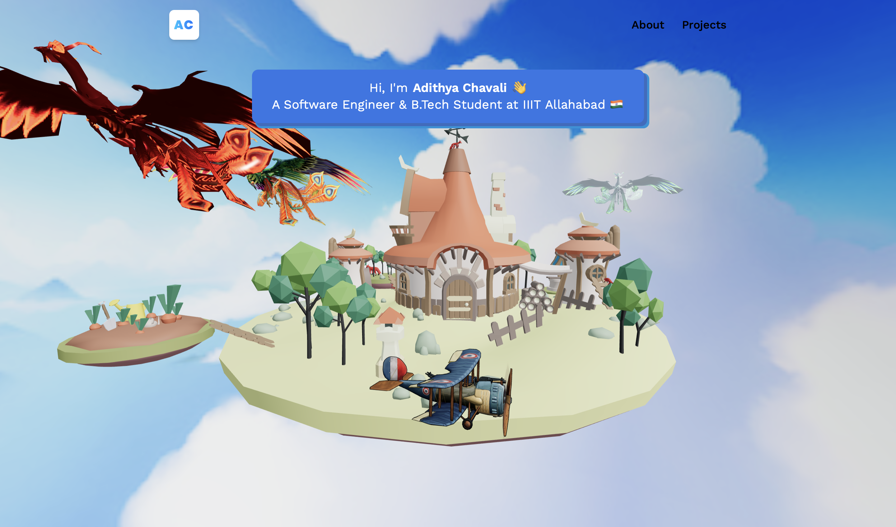
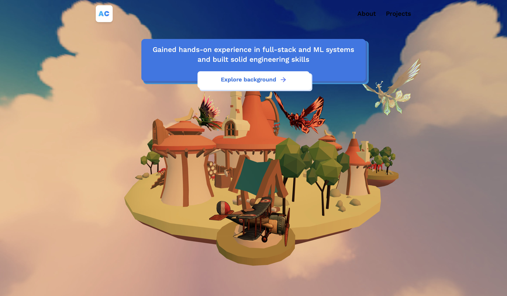
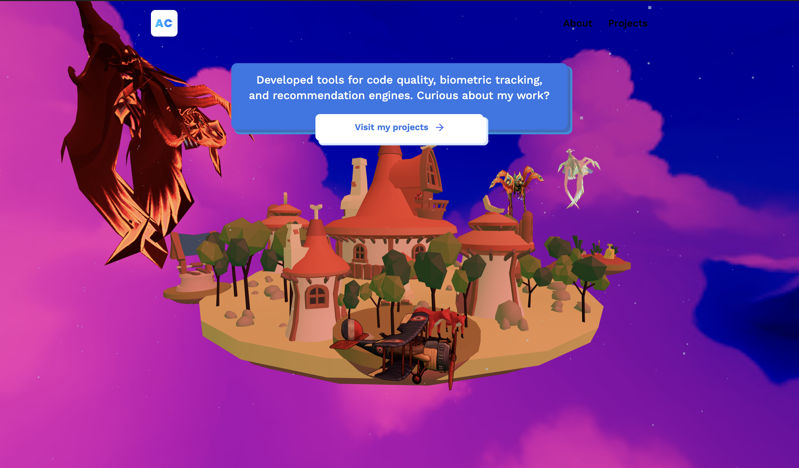
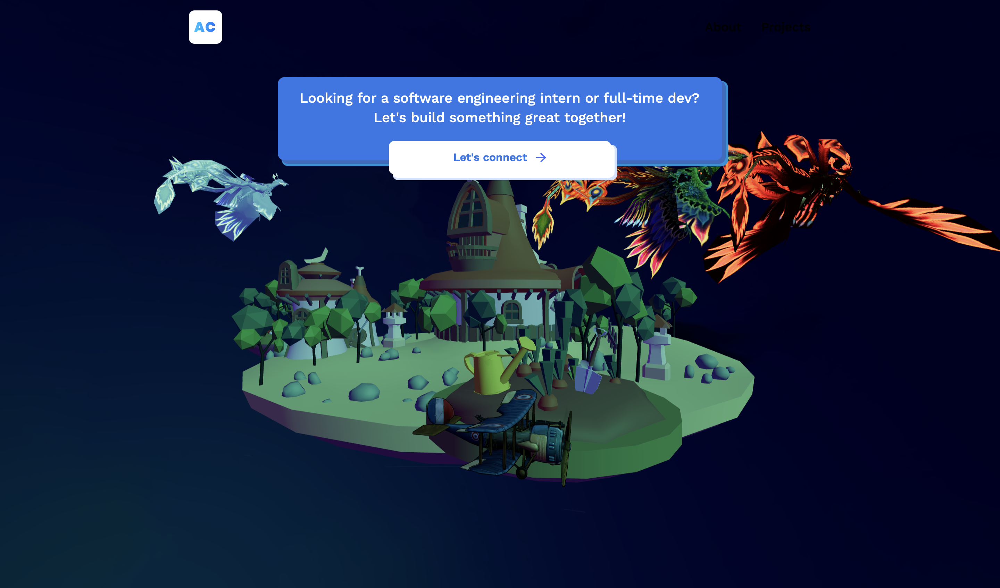

# Adithya Chavali — 3D Interactive Developer Portfolio 🚀

A state-of-the-art 3D developer portfolio featuring an immersive, interactive floating island world, custom mythical creatures, chronological day cycles, and 2D physics-based tilt control.

---

## 📸 Showcase

| **Morning (Home)** | **Afternoon (About)** |
| :---: | :---: |
|  |  |
| **Evening (Projects)** | **Night (Contact)** |
|  |  |

---


## 🌟 Key Features

### 1. Interactive 3D Island Navigation
* Rotate the island horizontally (yaw) to transition between different chapters of the portfolio.
* Snaps to active stages: **Home** (Morning) ➔ **About me** (Afternoon) ➔ **Projects** (Evening) ➔ **Contact me** (Night).

### 2. 2D Drag-to-Tilt (Vertical Tilt)
* Drag or swipe vertically to tilt the island along its pitch axis (`rotation.x`), clamped safely between `-0.1` and `0.35` to keep the island upright.
* Features realistic physics-based inertia damping. Tilting down lets visitors look up at the starry sky dome and watch the flying creatures fly above.

### 3. Chronological Day-Night Cycle & Smooth Transitions
* Decoupled state logic separates the popup info cards from the persistent environment backdrop. As you rotate, the lighting, sky dome, and gradient colors blend smoothly without jarring flashes.
* **Stage 1 (Morning - Home)**: Sunny, bright blue sky with fresh morning lighting.
* **Stage 2 (Afternoon - About me)**: Warm golden-orange sunset with bright golden keylights.
* **Stage 3 (Evening - Projects)**: Vibrant pink-magenta sunset with ambient evening glows and rain particles.
* **Stage 4 (Night - Contact me)**: A glowing purple-indigo-green CSS gradient blends with the 3D starry sky dome (using `renderOrder = -1` and `opacity = 0.45`), creating a deep Northern Lights aurora.

### 4. Mythical Soaring Creatures
* Three distinct flying species circling the island in non-overlapping orbits (radii `24`, `29`, `34` at altitudes `6`, `10`, `7`).
* Fixed skeletal animation culling so their wings flap organically rather than staying static.
  * **Fiery Phoenix**: Keeps the default colorful GLB textures and warm gold tints.
  * **Ice Eagle**: Translucent cyan-white icy body (`opacity = 0.85`, `#e0f2fe`) with a glowing neon emissive core (`#00f3ff`).
  * **Red Fire Dragon**: Scale increased for size (`0.026`), with a metallic crimson red body (`#991b1b`) and glowing red energy wing-tips/accents (`#ef4444`).

### 5. Glassmorphic Contact Cards
* The Contact screen renders a responsive glassmorphic card interface featuring direct links to Email (`adithya3218@gmail.com`) and Call/WhatsApp (`+91-8143873683`).

---

## 🛠️ Tech Stack
* **Frontend**: React, Vite, Tailwind CSS
* **3D Graphics**: Three.js, React Three Fiber (R3F), React Three Drei, `three-stdlib`
* **Animations**: `@react-spring/three`
* **Integrations**: EmailJS (for the contact message system)

---

## 📦 Project Setup

### Installation
Install the project dependencies:
```bash
npm install
```

### Run Locally (Development)
Spin up the hot-reloading Vite dev server:
```bash
npm run dev
```
Open **http://localhost:5173/** in your browser.

### Build (Production)
Compile and bundle the project for production:
```bash
npm run build
```
The output assets will be generated in the `dist/` folder.
